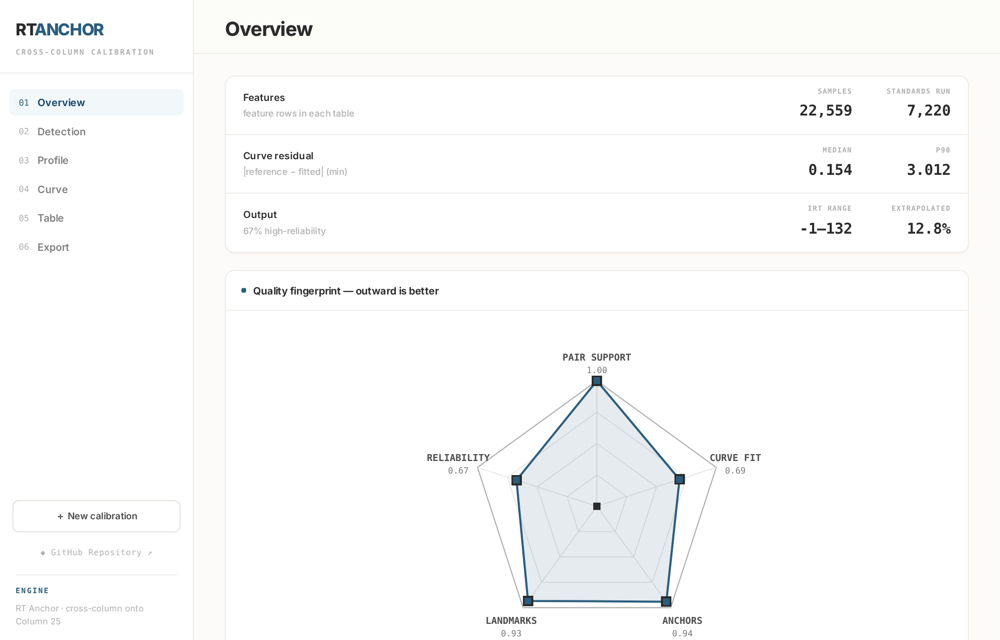
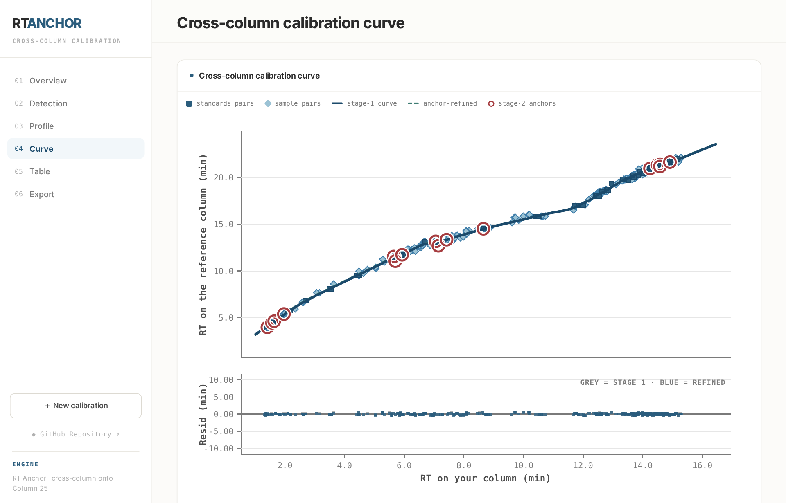
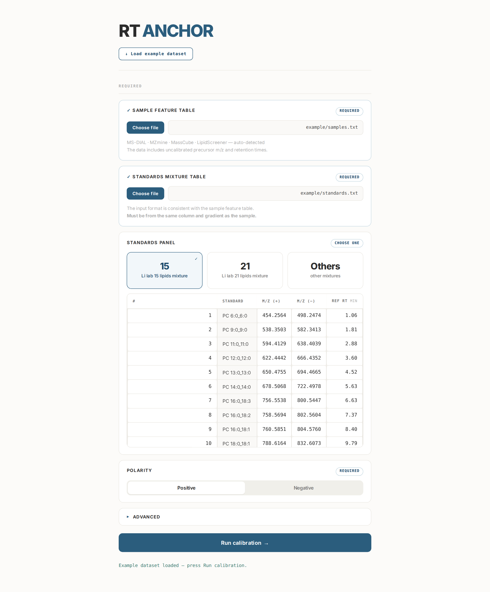
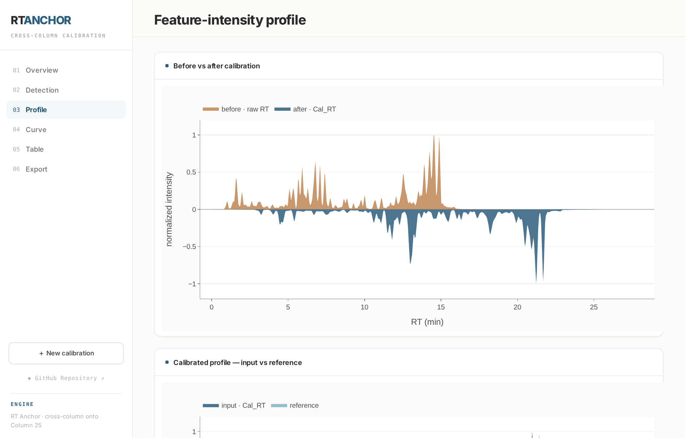

# RT Anchor

**Cross-column retention-time calibration for LC-MS lipidomics.**

RT Anchor maps every feature of an LC-MS run onto a reference column's time axis
(`Cal_RT_min`) and a 1–100 retention index (`iRT`), so retention times are
comparable across columns, gradients, instruments and labs. It is a Python
package (library, CLI, HTML/PDF report) and a desktop app for macOS and Windows.

<p>
  
  
</p>

## Download

- **Desktop app** — [latest release](https://github.com/Bowen999/rt-anchor/releases/latest)
  - macOS (Apple Silicon): the `.dmg`. Drag **RT Anchor** to Applications; on first launch, right-click → **Open**.
  - Windows 10/11 x64: the `.zip`. Unzip and run `RT Anchor.exe` (needs the WebView2 Runtime).
- **Python package** — `pip install rt-anchor` ([PyPI](https://pypi.org/project/rt-anchor/)); add `[report]` for the HTML/PDF report.

## Quick start

```python
from rt_anchor import calibrate, write_results

res = calibrate("samples.txt", polarity="positive",
                standards_table="standards.txt", panel="mix21")
write_results(res, "out/run1")
```

```bash
rt-anchor calibrate --samples samples.txt --standards standards.txt \
                    --polarity positive --panel mix21 --out out/run1
```

Walk-through with bundled data: [`examples/quickstart.ipynb`](examples/quickstart.ipynb).

## Inputs and outputs

| Input | |
|---|---|
| **Sample feature table** | MS-DIAL · MZmine · MassCube · LipidScreener, auto-detected |
| **Standards run** | standards mixture from the same column and gradient as the sample |
| **Panel** | `mix15`, `mix21` (default) or `none` |
| **Polarity** | `positive` or `negative` |
| *Reference pair* (optional) | bundled `col35` by default |

Outputs: `*_calibrated.csv` (the input table plus `Cal_RT_min`, `iRT`,
uncertainties, reliability tier, extrapolation flag and series/lattice columns),
`*_model.json`, `*_pairs.csv`, `*_landmarks.csv`, `*_anchors.csv`, `*_log.txt`,
`*_report.html` and `*_report.pdf`.

## How it works

1. **Stage 1 — curve.** Standards-run features are matched to the reference run by *m/z* (15 ppm); a robust monotone curve (LOESS → isotonic → PCHIP) maps your RT onto the reference column.
2. **Stage 1b — series term.** Features are corrected with the curve residuals of their homologous series, found from *m/z* by Kendrick mass.
3. **Stage 1c — lattice term** (since 1.2.3). The same correction across series one double bond apart.
4. **Stage 2 — sample anchors** (opt-in: `use_sample_anchors=True` / `--sample-anchors`). Seventeen endogenous plasma lipids refine the curve.
5. **iRT.** The panel's standards on the reference run set the scale: earliest 1, latest 100.

Stages 1b–2 apply only where a leave-out gate shows at least 20% lower error.
Parameters and accuracy: [`rt_anchor/README.md`](rt_anchor/README.md). Method specification: [`docs/RI_CALIBRATION_SPEC_V2.md`](docs/RI_CALIBRATION_SPEC_V2.md).

## Desktop app

Pick the two runs, the panel and the polarity, browse the results (Overview · Detection · Profile · Curve · Table · Export) and export everything in one click. Build notes: [`RT Anchor Desktop/README.md`](RT%20Anchor%20Desktop/README.md).

<p>
  
  
</p>

## Development

```bash
pip install -e "rt_anchor[test,report]"
pytest rt_anchor/tests
```

## Contact

Questions and bug reports: Bowen Yang (by8@ualberta.ca).
